<!--
  Profile README for github.com/az-said/az-said
  The picture element auto-swaps dark/light based on the viewer's GitHub theme.

  To switch the portrait look later, either:
    A) edit config.py  ->  "portrait_mode": "truecolor" | "neon" | "duotone"
       and "portrait_style": "pixel" | "ascii" | "braille", then run:  python3 generate.py
    B) or point the srcset below at a ready-made alternate in ./out:
       alt_truecolor_{dark,light}.svg, alt_neon_{dark,light}.svg, alt_ascii_{dark,light}.svg
-->

<picture>
  <source media="(prefers-color-scheme: dark)"  srcset="./out/dark_mode.svg">
  <source media="(prefers-color-scheme: light)" srcset="./out/light_mode.svg">
  
</picture>

 

&nbsp;

---

### Selected work

| | | |
|---|---|---|
| **[Peptide Visual Lab](https://az-said.github.io/peptide_prediction/)** | Structure prediction for amyloid and antimicrobial peptide research. Technion and DESY-CSSB Hamburg. | 50+ researchers across 4 labs · adopted by HIFIS · 2 PyPI packages · [code](https://github.com/az-said/peptide_prediction) |
| **[Study Buddy](https://study-buddy-dhz.pages.dev)** | A desktop pet whose mood is computed from your real Canvas workload, so it never asks whether you studied. AppDev@MIT. | Python 3.13 · PySide6/QML · 277 tests, 171 headless in 0.39s · source private under club policy |
| **[Interlock](https://interlock-self.vercel.app)** | Commit gate making AI agent payments at-most-once and auditable. | Plain retry pays wrong in 9 of 10 injected faults; the gate, 0 |
| **[MEET Crowdfunding](https://meet-kickstarter.com)** | Investment platform for student startups, built solo end to end. | 7,000+ users · 14 startups · shipped in 44 days · 3 languages, full RTL |
| **[RoofMate](https://github.com/az-said/RoofMateExpoNight)** | Roommate matching for Israeli and Palestinian students, on habits rather than nationality. | 500+ signups · 4 university partnerships · 11-person team |

MIT '30, Course 6-14. Research infrastructure, desktop apps, and things students actually use.

**[saidazaizah.com](https://saidazaizah.com)**

